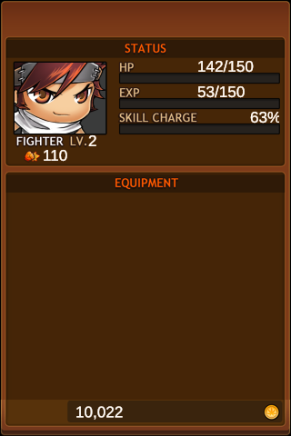
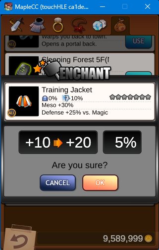

# MapleStory: Cave Crawlers — Preservation Runtime (touchHLE Fork)

[](https://github.com/j-dbooth/touchHLE-maplecc/releases)
[](https://www.rust-lang.org/)
[](https://opensource.org/licenses/MPL-2.0)
[](https://en.wikipedia.org/wiki/MapleStory)

A dedicated, enhanced preservation fork of **[touchHLE](https://touchhle.org/)** engineered specifically to run Nexon's 2011 iOS exclusive dungeon crawler **MapleStory: Cave Crawlers** (`com.nexonmobile.mscc`, v1.0.1) with 100% playable features on modern **Windows (10/11)** and **Android** devices.

---

## Gameplay Screenshots

<p align="center">
  
  
  
  
</p>

---

## Why This Fork Exists

*MapleStory: Cave Crawlers* was released in 2011 for iOS by Nexon Mobile and delisted over a decade ago. It represented a unique rogue-lite spin-off in the MapleStory franchise featuring real-time dungeon exploration, crafting, equipment enchanting, and multi-floor cave crawling.

Until now, the game was unplayable on modern platforms:
- Early iOS devices that could run it are long dead or obsolete.
- Vanilla touchHLE failed with severe crashes, black screens, memory corruptions, and non-functional in-app purchases.

This fork provides **over 9,600 lines of fixes and new framework implementations** to make the game fully playable from start to finish.

---

## Key Enhancements & Fixes in this Fork

### 🛒 1. Offline Meso Cash Shop (No Defunct Apple Servers Needed)
- In the original game, inventory expanders, scrolls, and potions were locked behind Apple In-App Purchases (`StoreKit`).
- We reimplemented the Cash Shop runtime: **all Cash Shop items now cost in-game Mesos** earned from dungeon crawling!
- **90% Gold Ingot Discount**: Reduced high-tier ingot costs by 10x for balanced offline progression.
- Asynchronous payment queue transaction emulation ensures purchase dialogs close cleanly without hanging.

### 🎨 2. OpenGL ES 1.1 on GL2 Translation Engine
- Fixed missing vertex pointer stride calculations and texture coordinate normalization (`GL_TEXTURE_COORD_ARRAY`).
- Dungeon floors, walls, monster sprites, and animated spell effects render cleanly at 60 FPS without tearing or missing textures.

### 🧬 3. Modern Objective-C 2.0 Sliding Ivars
- Early 32-bit iOS runtimes frequently suffer memory corruption when subclasses add fields to base classes.
- Implemented Apple's non-fragile instance variable layout engine to dynamically recalculate ivar offsets at runtime, preventing memory overlap in custom game classes.

### 🔨 4. Equipment Enchanting Animation Crash Fix
- Implemented missing `UIImageView` animation properties (`animationRepeatCount`, `animationImages`, `startAnimating`, `stopAnimating`).
- Enchanting weapons and armor at the town blacksmith now plays the full star-upgrade animation smoothly without crashing.

### 💍 5. Accurate Accessory Stat Rolling (`NSScanner` Fix)
- Resolved an integer tokenization bug where negative sign separators in option ranges (e.g. `AddEXP_1*1-10`) were swallowed.
- Rings and necklaces in the Town merchant shop now accurately roll and display their bonus values (`EXP +10%`, `Damage +15`, `Evade +5%`, etc.) instead of `+0%`.

---

## How to Play on Windows

### Quick Start (No Compilation Required)

1. **Download the Portable Release**:
   * Grab `MapleStory_Cave_Crawlers_Windows_Portable.zip` from [Releases](https://github.com/j-dbooth/touchHLE-maplecc/releases).
   * Extract the `.zip` anywhere on your PC.

2. **Add Your Game File**:
   * Obtain the unmodified `MapleStory_Cave_Crawlers_1.0.1.235.ipa` (available on retro preservation archives like the [Internet Archive](https://archive.org)).
   * Simply **drag and drop your `.ipa` file onto `Install_Game.bat`** (or place the file inside the `touchHLE_apps/` folder).

3. **Play**:
   * Double-click **`Play_MapleCC.bat`** to start playing immediately!
   * All save data and progress are stored locally within the folder.

### Windows Controls
| Action | Input |
|---|---|
| Tap / Interact | Left Mouse Click |
| Drag / Scroll | Left Mouse Hold & Drag |
| Accelerometer (Tilt) | Hold Right Mouse Button + Move Mouse |
| Back / Pause | In-game back button / touch |

---

## How to Play on Android

Because *MapleStory: Cave Crawlers* was originally a touch-driven iOS title, playing it on an Android phone or tablet delivers the authentic native mobile experience!

1. **Download & Install APK**:
   * Download `touchHLE_MapleCC.apk` from the latest [Release](https://github.com/j-dbooth/touchHLE-maplecc/releases) or GitHub Actions build artifacts.
   * Sideload / install the APK on your Android device (Android 5.0+ / 64-bit ARM AArch64).

2. **Initialize Folders**:
   * Launch touchHLE once on your device, then close it so it creates its directory structure.

3. **Transfer Game Files**:
   * Connect your phone to your PC or use an Android file manager (like *Files by Google* or *ZArchiver*).
   * Place `MapleStory_Cave_Crawlers.ipa` (or extracted `MapleCC.app`) into:
     ```text
     /sdcard/Android/data/org.touchhle.android/files/touchHLE_apps/
     ```

4. **Launch**:
   * Open touchHLE, tap **MapleStory: Cave Crawlers**, and enjoy native touchscreen controls!

---

## Building from Source

### Prerequisites
- [Rust toolchain](https://www.rust-lang.org/) (stable)
- CMake & Ninja (on PATH)
- Git

### Build for Windows (x64)
```powershell
# Clone the repository
git clone -b maplecc-support https://github.com/j-dbooth/touchHLE-maplecc.git
cd touchHLE-maplecc

# Build optimized release binary
cargo build --release

# The compiled binary will be at: target/release/touchHLE.exe
```

### Build for Android (AArch64 APK)
```bash
# Add Android target
rustup target add aarch64-linux-android
cargo install cargo-ndk@3.5.4

# Set NDK path (version 25.2.9519653 / r25c recommended)
export ANDROID_NDK_ROOT=/path/to/android-ndk

# Build release APK via Gradle
cd android
./gradlew assembleRelease
# Output APK: android/app/build/outputs/apk/release/app-release.apk
```

---

## Legality & Disclaimer

- **Emulator Software**: This project is open-source software licensed under the **Mozilla Public License, v. 2.0** (`COPYING.txt`). It contains clean-room reverse engineered stubs and high-level framework implementations.
- **No Copyrighted Assets Distributed**: This repository does **not** host, bundle, or distribute any proprietary game binaries, artwork, sound files, or intellectual property belonging to Nexon. Users must provide their own legally dumped or preserved copies of the original `.ipa`.
- **Trademark Notice**: *MapleStory*, *MapleStory: Cave Crawlers*, and all associated logos, characters, and assets are trademarks and copyrights of **Nexon Co., Ltd. & Nexon Mobile**. This project is an unofficial non-profit historical software preservation effort.
- **Upstream Project**: Built upon the foundational work of [touchHLE](https://touchhle.org/) created by [hikari\_no\_yume](https://hikari.noyu.me/) and community contributors.
